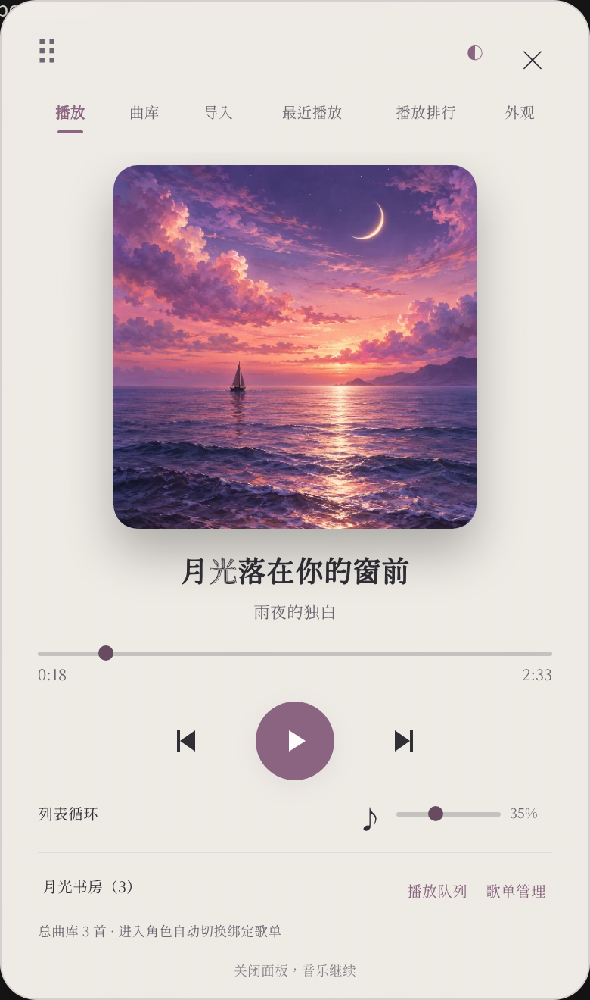
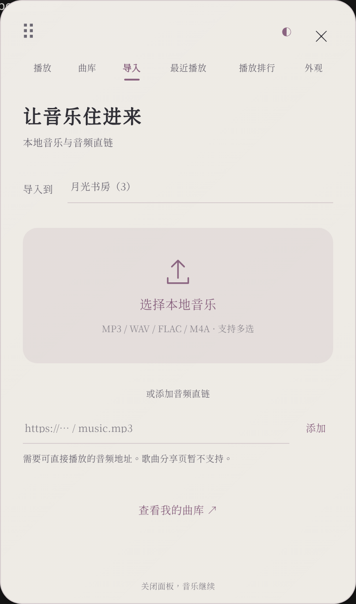

# 音乐播放器

在 SillyTavern 聊天时听音乐的小扩展。无需 API Key、Extras 服务或额外后端，也不需要编译。



## 安装

1. 打开酒馆的 **扩展** 面板，点击 **安装扩展**。
2. 粘贴以下仓库地址并安装：

   ```text
   https://github.com/riserein/sillytavern.git
   ```

3. 刷新酒馆页面，点击右下角的 **♫** 按钮。也可以在扩展设置中点击“打开音乐播放器”。

这是酒馆的**前端扩展**，不放在服务器的 `plugins` 目录。建议使用最新稳定版 SillyTavern；本插件在 1.19.0 上进行集成测试。

## 使用

播放器分为 **播放、曲库、导入、最近播放、播放排行、外观** 六个页面。播放页使用中央大封面、歌名与歌手、进度条和圆形播放按钮；曲库页只整理歌曲与歌单，导入页单独添加歌曲。歌单管理默认收起，按需展开，减少界面上的表单和边框。切换页面不会中断音乐。

- **本地音乐**：在 **导入** 页点击“选择本地音乐”，可一次导入多个文件。
- **在线音乐**：在 **导入** 页粘贴可直接播放的 HTTP / HTTPS 音频地址，点击“添加”。网易云、QQ 音乐、YouTube 等分享页面不是音频直链。
- **播放控制**：播放/暂停、上一首/下一首、拖动进度条、音量和静音。
- **播放模式**：顺序播放（最后一首结束后停止）、列表循环、单曲循环、随机播放。单曲循环时仍可手动切歌。
- **总曲库**：点击歌曲开始播放，点击右侧 × 从曲库删除。总曲库最多 200 首，单个本地文件最大 100 MB。
- **后台听歌**：关闭播放器面板不会停止音乐；刷新或关闭酒馆页面会停止，刷新后不会自动播放。
- **拖动悬浮球**：按住 ♫ 拖动，松开后停留在新位置。轻点才会打开或关闭播放器，拖动不会误触打开。
- **拖动窗口**：按住窗口顶部的点阵或空白区域拖动。鼠标和触屏均可使用，播放、配色和关闭按钮保持正常操作。
- **记住位置**：悬浮球和窗口的位置分别保存；屏幕尺寸改变后会缩放并限制在可见范围内。需要恢复初始位置时，打开 **外观** 页并点击“重置悬浮球与窗口位置”。
- **键盘移动**：聚焦悬浮球或窗口顶部后，使用方向键移动；按住 Shift 可加快移动。

支持 MP3、WAV、OGG、M4A 等常见音频，实际支持的格式取决于浏览器。在线地址还需允许浏览器直接访问；HTTPS 酒馆需要使用 HTTPS 音乐地址。



## 封面与歌词

播放页中央为大幅方形封面，进度条在下方。**轻点封面切换到歌词，再点一次切回封面**，切换不会打断音乐。“播放队列”按需展开，不再把整份歌曲列表堆在播放页。

导入本地 MP3 时，会读取 ID3v2.2 / v2.3 / v2.4 中的歌名、歌手、封面和非同步歌词。MP3 没有内嵌封面、其他格式未解析封面，或当前浏览器缺少封面文件时，会使用扩展自带的三幅插画：月夜森林、暮色海面、暖光书房。无封面的歌曲随机匹配一幅，结果随歌曲保存，刷新不随意更换。默认封面随插件提供，可离线使用。

在 **曲库 → 歌曲右侧 ⋯** 中可以为该歌曲 **添加封面**、**导入歌词**、恢复随机封面或清除歌词。封面会处理为轻量方形图片；删除歌曲时同时清理本地音频和封面。支持 UTF-8 编码的 `.lrc`、`.txt` 歌词文件，最大 512 KB、50000 字符。

有时间轴的 LRC 会随播放、拖动进度高亮并跟随当前句，普通文本歌词可滚动阅读。没有歌词时明确显示“暂无歌词”。本插件不会自动抓取网易云、QQ 音乐等平台的歌词；音频直链不能保证提供歌曲封面和歌词。


## 歌单与总曲库

播放页的歌单下拉框可以在总曲库与各个歌单之间切换。点击 **歌单管理** 会进入独立的 **曲库** 页，也可以直接点击顶部的“曲库”，再点 **管理歌单** 展开管理表单。输入名称并点击 **新建**；选中歌单后可以改名、删除或绑定角色。两页的歌单选择保持同步，最多可以创建 50 个歌单。

在独立的 **导入** 页，可以先用 **导入到** 选择目标歌单。默认的“不选择 · 仅加入总曲库”只把歌曲加入总曲库；选择歌单则同时加入总曲库与该歌单。浏览某个歌单不会自动改变导入目标。

已有曲库歌曲右侧的 **＋** 可以把歌曲加入任意歌单，同一首歌可以加入多个歌单，不会复制音频文件。已有直链再次添加到另一个歌单时，也会复用曲库中的歌曲。

- 歌单中歌曲右侧的 **−**：仅从当前歌单移除，曲库及其他歌单仍保留歌曲。
- 歌曲右侧的 **×**：确认后从总曲库和所有歌单中删除，并删除当前浏览器保存的本地音频副本。
- **删除歌单**：只删除歌单及其角色绑定，所有歌曲和音频文件都保留在总曲库。

上一首、下一首和自动循环只在当前歌单内切歌。切换歌单会暂停音乐，需要手动点播放。旧版本更新后，已有歌曲会保留在总曲库，无需重新导入。


## 绑定角色卡

1. 在 **曲库** 页选择要绑定的歌单，展开 **管理歌单**，点击 **绑定角色**。
2. 勾选一张或多张角色卡，点击 **保存绑定**。
3. 进入已绑定的角色聊天时，播放器会自动打开并切到该歌单，**只切歌单，不自动播放**；点击播放才开始听歌。

一张歌单可以绑定多张角色卡；每张角色卡使用一个自动切换的歌单。重新绑定角色时，会改用新选择的歌单。绑定使用角色卡文件标识，角色列表排序变化不会导致绑定错位；通过酒馆改名角色卡时也会更新绑定。

切换到另一张角色卡会先暂停当前音乐，再显示其绑定歌单；没有绑定的角色显示总曲库。同一角色内更换对话不会重复打断音乐。**退出角色聊天回到主页面时自动暂停**，群聊不会加载单人角色的绑定歌单。


## 配色与质感

打开 **外观** 页，或点击窗口顶部的 **◐**，即可切换六组配色：暖砂、雾蓝、松绿、烟粉、月紫和珍珠白。悬浮球会跟随播放器使用同一组配色，更新版本会保留已有播放列表。

每组配色都支持两种质感：**雾面**使用细微颗粒和接近不透明的柔和底色，**毛玻璃**使用半透明背景、背景模糊和高光边缘。配色与质感会随酒馆设置保存，切换外观不会停止音乐。

在 **外观 → 遮罩透明度** 中可以拖动滑杆：0% 的遮罩完全不透明，100% 完全透明。雾面和毛玻璃分别记忆，切换质感不会丢失各自设置；点击 **重置透明度** 恢复当前质感的默认值。没有图片时也可以调整播放器底色的透明度，清透模式固定为完全透明。透明度只改变遮罩，毛玻璃的模糊仍然保留。

**自定义配色** 可以分别选择点缀色、背景色和文字色，修改颜色后立即生效，并同步到悬浮球。播放按钮上的文字会根据点缀色选择深浅颜色。点击六组预设之一会恢复预设配色，自定义颜色仍然保留，可以重新勾选启用。颜色、透明度和背景图片可以一起使用，均随当前酒馆用户设置保存。

**点击涟漪动效** 会在播放器按钮和悬浮球上显示轻柔的扩散光圈，支持鼠标、触屏和键盘点击。不会给酒馆其他界面添加动效，也不会把拖动误判为点击。在外观页取消勾选即可关闭；系统启用“减少动态效果”时也会自动关闭光圈。


## 字体选择与导入

在 **外观 → 界面字体** 中可以选择跟随酒馆、清爽黑体、典雅宋体、温润楷书、书卷仿宋，以及 **源雲明體 · 内置**。系统字体的实际显示取决于设备已有的字体；播放器和歌词使用选择的字体，酒馆其他界面不会改变。

**源雲明體 GenWanMin2 TC R** 就是所提供 CSS 中使用的字体，已从 [官方项目](https://github.com/ButTaiwan/genwan-font)取得完整字库并内置，保留 35349 个 Unicode 字符映射，转换为 WOFF2 容器以缩小下载体积，不需要访问外部字体站。该字体使用 SIL Open Font License 1.1，授权文件随扩展提供。

也可以点击 **导入字体** 使用自己拥有的 WOFF2、WOFF、TTF 或 OTF 文件，最大 20 MB。可以导入京华老宋体或其他喜欢的字体；这里只使用用户选择的本地文件，不会把字体上传到 GitHub 或酒馆服务器。自定义字体保存在当前浏览器，其他设备需重新导入；内置源雲明體随扩展在所有设备上可用。点击 **移除字体** 可清理导入的副本。

## 自定义背景与裁剪

在 **外观 → 导入背景图片** 中选择图片，然后拖动预览中的图片、调整缩放，或使用“左右”“上下”滑杆选取喜欢的区域，点击 **使用此区域**。图片会裁剪为竖幅背景；手机和电脑都可以操作。支持 PNG、JPG、WebP、GIF、AVIF，最大 10 MB、4000 万像素；动图会使用静态画面。

导入图片后，六组配色继续控制按钮、文字和图片上的色调。**雾面**在图片上叠加细微颗粒和柔和色层，**毛玻璃**模糊图片并叠加半透明色层，新增的 **清透** 则直接使用裁剪后的图片，不叠加模糊或色层。清透仅在当前浏览器已加载背景图片时可用。


点击 **重新裁剪** 可以从保存的原图重新选取区域；取消不会改变已有背景。点击 **移除图片** 恢复原有配色背景，如果正在使用清透，会自动恢复毛玻璃。背景原图和裁剪结果仅保存在当前浏览器，不上传到 GitHub 或酒馆服务器。其他设备需要重新导入。

## 最近播放与三天排行

- **最近播放**：显示最近实际听过的 100 首不同歌曲，最近播放的排在前面；再次播放同一首会移到最前面，不重复占位。时间记录不受三天限制。
- **播放排行**：统计滚动最近 **72 小时**内的播放次数，从高到低排列；次数相同时最近播放的在前面。歌曲实际开始播放才计数，暂停后继续不重复计数；手动重新选歌、切回同一首、自动循环重播会计为新的播放。加载失败或只切换角色歌单不计数。
- 两页都可以点击歌曲播放；歌曲不在当前歌单时会切换到总曲库播放。删除歌单保留歌曲及播放记录，从总曲库删除歌曲则同时移除其记录。

播放记录从升级到 1.3.0 后开始收集，刷新后保留，不会自动播放。旧版本没有记录的历史无法补回。


## 保存与隐私

总曲库、歌单、角色绑定、当前曲目、歌词、随机封面选择、播放记录、播放模式、音量、外观和窗口位置随酒馆用户设置保存。本地音频、歌曲封面、导入的字体、背景原图及裁剪后的背景保存在**当前浏览器的 IndexedDB**，不会上传到酒馆服务器，也不会进入聊天内容。

更换设备、浏览器或酒馆地址后，需要重新导入本地音乐；清理站点数据也会删除本地文件。其他设备可以看到播放列表中的名称，但不能播放尚未在该设备导入的本地文件。删除本地条目时会同时删除当前浏览器里对应的音频。

直链由浏览器向对应音乐网站请求。插件没有内置曲库，不依赖第三方音乐搜索或登录接口。

## 预置音乐与公开直链

你在播放器中添加的直链和本地音乐属于自己的酒馆用户数据，不会自动写进 GitHub，也不会随别人安装插件而分发。要提供所有安装者都能看到的预置歌曲，需要另行把公开音频地址加入插件的默认曲目清单。

直链播放的过程是：插件把音频地址交给浏览器的音频播放器，安装者的浏览器从对应服务器请求音频。文件可以存放在独立的对象存储（如腾讯云 COS、阿里云 OSS、Cloudflare R2 搭配自定义域名）或自己的静态文件服务器上，插件只需要保存歌曲名称和地址。按需使用 CDN 加快不同地区的访问。

用于预置的地址应支持公开 HTTPS 访问、无需登录、不带短期到期签名，并允许音频外链；服务器支持 Range 请求会使拖动进度和继续加载更可靠。网盘分享页面、音乐平台歌曲分享页面不能直接当作音频直链。长期可用依赖存储服务、域名和访问带宽持续正常。

音频上传到独立服务器后，删除自己电脑上的原文件不会删除服务器副本，也不会影响别人播放。删除服务器上的文件、使链接失效或关闭访问权限则会影响后续播放。本地导入只会复制音频到自己的浏览器，删除电脑上的原文件后当前浏览器仍可播放，但其他人不会获得这份音频。

当前版本不支持导入网易云、QQ 音乐或酷狗的公开歌单，也不会自动获取平台歌曲封面与歌词。歌单分享链接仍不能当作音频直链添加。

## 更新与卸载

在酒馆的扩展管理中点击本扩展的更新按钮，更新后刷新页面。卸载可使用酒馆的扩展删除功能；如需清理本地音频，请先删除播放列表中的本地条目。卸载扩展本身不会自动清理浏览器站点存储。

## 开发与测试

运行时无需安装 npm 依赖，`manifest.json`、所有根目录 JS/CSS 文件和 `assets/` 目录可以直接由酒馆加载。手动安装时请保留 `assets/`，其中包含内置封面和字体。

开发测试需要 Node.js 20 或以上：

```sh
npm ci
npm run check
npm test
```

浏览器集成测试需要**用于测试的独立酒馆用户数据目录**，测试会重置该用户的播放器列表与设置，并创建、删除临时角色卡和对话。不要直接针对日常使用的酒馆运行测试。

1. 将本仓库克隆到测试酒馆的 `public/scripts/extensions/third-party/sillytavern` 目录，或在同一位置建立指向本仓库的符号链接。
2. 使用单独的配置和用户数据目录启动测试酒馆，例如：

   ```sh
   node server.js --port 8000 --browserLaunchEnabled false --dataRoot /path/to/test-data
   ```

3. 在本插件目录运行：

   ```sh
   npx playwright install chromium
   ST_BASE_URL=http://127.0.0.1:8000 npm run test:e2e
   ```

   已安装 Chromium 的环境可以跳过浏览器下载，使用 `CHROMIUM_PATH=/usr/bin/chromium npm run test:e2e`。

测试覆盖真实酒馆扩展加载、本地音频播放、进度与音量、切歌与四种模式、刷新恢复、音频直链、删除与存储清理、错误提示、鼠标及触屏拖动、位置恢复与越界限制、六种配色和两种质感、手机屏幕布局、导入目标、共享歌曲、歌单删除保留音频、多角色绑定及主页暂停。测试使用真实角色切换 API，并检查退出时仍在读取的本地音乐不会继续播放或重新打开旧歌单。测试音频由代码生成，不依赖外部曲库。

1.3.0 的测试还验证独立页面和键盘导航、实际播放记录与暂停去重、100 首上限、72 小时排行到期、背景裁剪区域的实际像素、三种质感、背景刷新恢复和原图清理，以及手机裁剪与错误恢复。

1.4.0 增加自定义颜色、独立遮罩透明度及刷新恢复、预设切换、点击光圈生命周期、减少动态效果和拖动不误触验证。

1.5.0 验证独立曲库与导入页面、实际 MP3 播放和内嵌标签读取、封面/歌词切换、LRC 跟随、封面刷新与删除清理、三张内置封面、内置字体离线加载、自定义字体导入/恢复/失败保护，以及字体不影响酒馆其他界面。测试音频由本项目生成的正弦音组成。

## 许可

扩展代码和本项目生成的默认封面使用 [MIT](LICENSE)。内置 GenWan 字体独立使用 [SIL Open Font License 1.1](assets/fonts/OFL-GenWanMin.txt)，来源与转换说明见 [字体说明](assets/fonts/README.md)。
