# 音乐播放器

当前开发版本 **v2.0.0-alpha.6**：全局文字可读性、歌词自由阅读和共享阅读偏好已更新，见[专项说明与验收](docs/readability/README.md)。保留收藏、睡眠定时、柔和过渡；四种播放器布局、五种悬浮入口；实时设计器、「我的设计」及安全 JSON 分享；角色独立 UI/字体与原生 PNG/JSON 分发。旧用户默认仍是夜航。在「外观 → 播放器形态」打开设计器，制作页可选择共享布局。见[设计器使用](docs/v2/ui/editor.md)、[随卡导出](docs/v2/ui/shared-export.md)、[悬浮组件](docs/v2/ui/launchers.md)及[音乐功能](docs/v2/listening/README.md)。这是分阶段开发的预发布版本，真实设备等未验证边界会在最终报告中单独列明。

已发布稳定基线 **v1.13.3** 的[中文质量审计与测试边界](docs/quality-audit-v1.13.3.md)保留。原曲库、角色绑定、原生 PNG/JSON 随卡导出及夜航界面继续兼容。

**完整备份：**打开 **外观 → 数据备份与恢复**，导出包含本地原文件、图片、字体、歌词、歌单、绑定、偏好和制作项目的 ZIP；换设备时校验、预览并确认恢复。远程音乐只备份信息和链接。升级后的旧浏览器文件仍保留，须先确认归属再复制到账号独立存储。详见 [中文操作说明](docs/data-maintenance.md)。随卡 PNG/JSON 仅携带选定播放器，不能代替完整曲库备份。

在 SillyTavern 聊天时听音乐的小扩展。无需 API Key、Extras 服务或额外后端，也不需要编译。

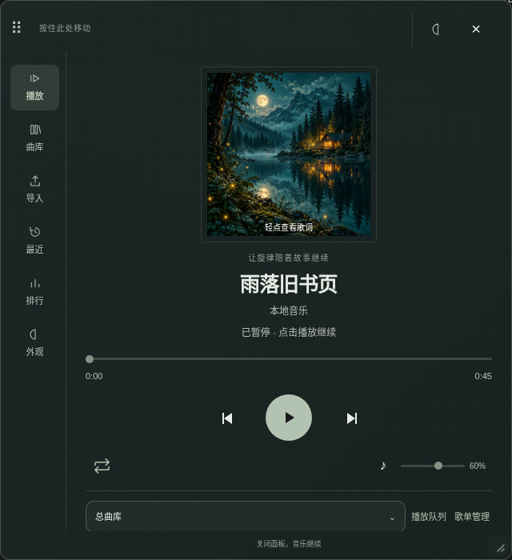

## 安装

1. 打开酒馆的 **扩展** 面板，点击 **安装扩展**。
2. 粘贴以下仓库地址并安装：

   ```text
   https://github.com/riserein/sillytavern.git
   ```

3. 刷新酒馆页面，点击悬浮的 **黑胶唱片** 按钮。也可以在扩展设置中点击“打开音乐播放器”。

这是酒馆的**前端扩展**，不放在服务器的 `plugins` 目录。建议使用最新稳定版 SillyTavern；本插件在 1.19.0 上进行集成测试。

## v1.13.1 随卡分发排错

曲库的“随卡分发：接收端没有播放器？”可以直接检查实际发送的 PNG / JSON。接收端不需要音乐插件，但需要酒馆助手允许角色脚本运行；首次弹窗若取消，可在酒馆助手脚本库手动启用。新导出脚本遇到启动错误会显示提示。旧卡须重新导出才会更新。详见[分发排错说明](docs/card-player/quality-user-guide.md#接收端看不到播放器时)。

## v1.13.0 质量完善

- 制作项目自动保存、恢复、复制及多项目管理，使用独立草稿库，不修改原音乐库。
- 逐项容量分析与导出后 PNG/JSON 静态核对；增加“检查 / 重建当前角色的随卡播放器”，保留歌曲和外观后重新导出。
- 修复初始化失败清理、响应体取消、脚本存储隔离和完整版接管等问题，保留原生 PNG/JSON 与共享播放器界面。
- 无歌词时可在歌曲详情主动搜索、预览并确认；制作页直接添加 MP3 也读取内嵌歌词。确认或导入后的歌词随卡携带。联网歌词依赖 LRCLIB；本云环境访问受阻，不能保证每首歌可匹配。

详见 [普通用户操作说明](docs/card-player/quality-user-guide.md)、[问题与修复清单](docs/card-player/quality-review-v1.13.0.md)、[测试及体积记录](docs/card-player/quality-validation-v1.13.0.json)、[跨浏览器与实体手机计划](docs/card-player/compatibility-plan-v1.13.0.md)。静态核对、浏览器解码、真实酒馆验收和实体手机测试分别记录。

## 使用

1.10.0 采用已确认的 **B「夜航听音」**：宽窗口左侧导航，窄窗口自动收成顶部导航，居中封面配合清晰的进度和播放控制。首次安装默认夜航配色；已有用户保留原配色、日夜模式、字体、背景和窗口位置，也可在 **外观 → 配色与材质 → 夜航** 切换。

播放器分为 **播放、曲库、导入、最近播放、播放排行、外观** 六个页面。播放页使用中央大封面、歌名与歌手、进度条和圆形播放按钮；曲库页整理歌曲与歌单，导入页提供“本地与直链、在线搜索、分享链接”三种入口。“我的音乐”先显示总曲库，再显示自建歌单；没有自建歌单时隐藏该分组。点击封面或名称进入歌曲列表，右上角可直接新建歌单。切换页面不会中断音乐。

- **本地音乐**：在 **导入 → 本地与直链** 中点击“选择本地音乐”，可一次导入多个文件。
- **音频直链**：在 **导入 → 本地与直链** 中粘贴可直接播放的 HTTP / HTTPS 音频地址，点击“添加”。网易云、QQ 音乐、YouTube 等分享页面不是音频直链。
- **播放控制**：播放/暂停、上一首/下一首、拖动进度条、音量和静音。
- **播放模式**：点击音量左侧的模式图标，在顺序播放（最后一首结束后停止）、列表循环、单曲循环、随机播放间切换；悬停和点击后的提示会说明当前模式。单曲循环时仍可手动切歌。
- **总曲库**：点击歌曲或最右侧透明播放键开始播放；当前歌曲再次点击会暂停，再点原地继续。点击右侧“⋯”打开详情，可加入歌单、编辑封面/歌词、从歌单移除或从曲库删除。总曲库最多 200 首，单个本地文件最大 100 MB。
- **后台听歌**：关闭播放器面板不会停止音乐；刷新或关闭酒馆页面会停止，刷新后不会自动播放。
- **拖动悬浮球**：按住悬浮唱片拖动，松开后停留在新位置。轻点才会打开或关闭播放器，拖动不会误触打开。
- **拖动窗口**：按住窗口顶部的点阵或空白区域拖动。鼠标和触屏均可使用，播放、配色和关闭按钮保持正常操作。
- **记住位置**：悬浮球和窗口的位置分别保存；屏幕尺寸改变后会缩放并限制在可见范围内。需要恢复初始位置时，打开 **外观** 页并点击“重置窗口大小与位置”。
- **调整窗口大小**：拖动窗口右下角的斜线，支持鼠标和触屏；聚焦该手柄后也可用方向键微调，Shift 加速。宽度限制为 320～720、高度为 420～960 个 CSS 像素；屏幕更小时以屏幕可用空间为上限。大小与位置都会记住，切换设备或旋转屏幕后自动限制在可见范围，外观页可一键重置。
- **键盘移动**：聚焦悬浮球或窗口顶部后，使用方向键移动；按住 Shift 可加快移动。

支持 MP3、WAV、OGG、M4A 等常见音频，实际支持的格式取决于浏览器。在线地址还需允许浏览器直接访问；HTTPS 酒馆需要使用 HTTPS 音乐地址。

曲库列表上方可按歌名/歌手查找、按歌名/歌手显示排序，或按本地、直链、在线、可播放/受限来源筛选。显示排序不修改永久歌单顺序。点“批量管理”可勾选歌曲并加入指定歌单、仅从当前歌单移除，或确认后从总库及所有歌单删除。歌单管理中可保存简介，并使用“调整歌曲顺序”的上下箭头修改永久顺序。删除歌单仍保留总曲库音乐。

**浏览歌单不会暂停音乐。** 点击另一张歌单中的歌曲才会切换播放来源；角色卡切换依然只切歌单、不自动播放，回主页仍暂停。

播放队列的上下箭头和移除按钮只影响本页的临时队列，不会改动永久歌单；当前歌曲不能直接移出。可点“恢复歌单顺序”重置。主动切换播放来源、切换角色或刷新页面后恢复来源歌单的顺序，音乐不会自动播放。已加入当前来源的新歌曲会补到队列尾部。

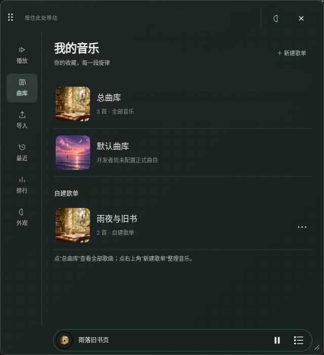

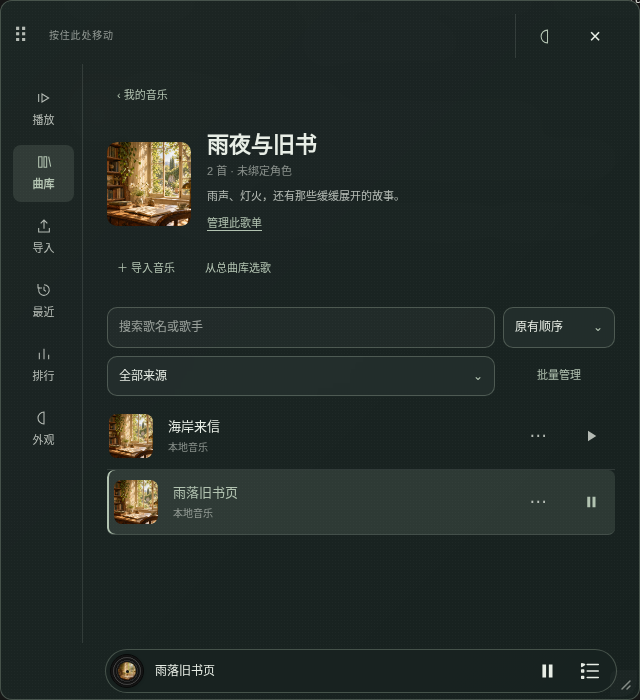

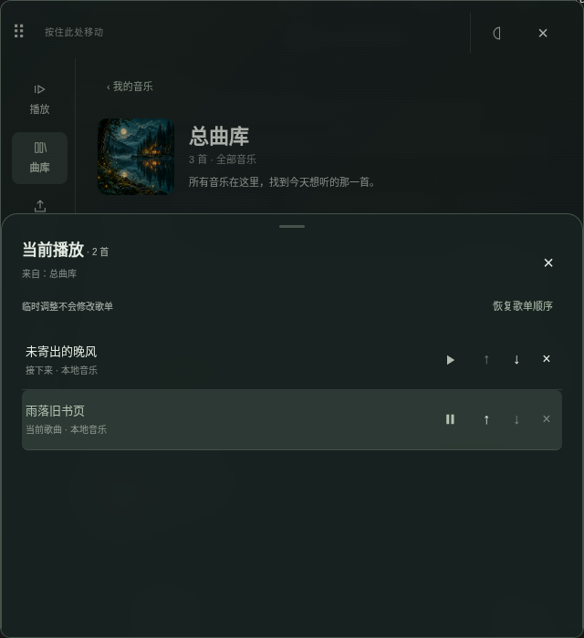

## 绑定歌单，直接导出角色卡（1.12.3）

在歌单管理中选择 **绑定角色 → 勾选目标角色 → 保存绑定**。等待“音乐已随卡保存”，然后直接用**酒馆自己的导出按钮**导出 **PNG 或 JSON**，即可分发角色卡。导出前会再次同步当前歌曲、封面、歌词、配色、背景和选定字体；资源检查失败时会说明原因并阻止本次导出。

使用者无需安装本音乐插件，但需要**酒馆助手并启用这张卡的角色脚本**。接收端直接使用现有播放器的界面、组件和样式，保留黑胶浮球、播放、曲库、最近播放、排行和外观页，移除音乐导入页与制作人入口。同角色聊天、切换开场白和聊天文件时复用同一个音频；离开角色时停止并清理。

**只携带作者导出时选中的一款字体。** 接收端固定使用该字体，没有字体切换或字体导入入口；完整插件仍可自由切换，换字体后重新导出的卡携带新选择。PNG 导出会核对并去除完全重复的角色数据副本，保留标准 V2 数据、头像与完整资源；不同内容的副本不会删除。JSON 本来就没有这层重复，大小主要取决于歌曲与所选字库。

本地音乐按字节随卡携带，删除作者电脑上的原文件不影响已发出的卡；直链仍需原网站保持可访问。单首内嵌音频最多 20 MB，打包资源合计最多 30 MB，脚本最多 45 MB；不支持把受限平台来源伪装成直链。内置仅保留两款小体积字体，随卡只携带选中的一款；旧版已移除字体的选择会回退为“跟随酒馆”。自定义字体仍需分发授权记录。已有制作页保留为可选高级工具。

[中文使用说明与限制](docs/card-player/export-guide.md) · [原生 PNG / JSON 验收](docs/card-player/native-validation.md) · [1.11 制作页历史验收](docs/card-player/export-validation.md)

## 在线搜索与分享链接（1.9.0）

**导入 → 在线搜索** 可搜索已启用的来源，查看歌名、作者、来源、时长和播放能力，选择顶部的“导入到”目标后加入曲库或歌单；可播放的结果可直接点播放。支持取消请求、缓存、加载更多和单来源失败提示。结果中的“检查播放”会尝试播放，并且只有观察到真实音频进度前进才显示通过；元数据返回或点击成功不能替代这项检查。只有已启用搜索的来源会出现在菜单中，“全部可用来源”不会假装包含尚未接入的平台。

当前默认接入 **Openverse 公开许可音频 API**，内容包括音乐与环境声等；只对具有明确 CC0、PDM、CC BY 或 CC BY-SA 许可及音频地址的记录尝试站内播放，界面保留作者、许可和来源。它的匿名配额有限，原站文件也可能失效。**本轮真实请求中，Openverse 返回 Cloudflare 验证页，Audius 搜索能返回数据但测试音频返回 403；云端 Chromium 的代理证书信任尚未配置，真实外网播放验收仍未通过**。具体见 [本轮阶段报告](docs/v1.9-audit.md) 和 [你自己电脑上的真实播放步骤](docs/live-playback-guide.md)。接口替身与生成音频的测试不算外网播放成功。

**导入 → 分享链接** 可粘贴整段分享文字。支持识别网易云、QQ、酷狗、酷我、咪咕、Spotify、YouTube Music、Apple Music、SoundCloud、Audius、Openverse 的标准歌曲或歌单链接。先预览，再确认保存；短链接、非标准页面需要先在官方平台打开完整地址。

- Openverse 单曲可读取音频信息。Audius 的搜索、歌曲与公开歌单适配器由维护者配置公开应用 Key 后启用，当前没有配置，普通用户不填写 Key。
- 尚未接入元数据的平台歌曲可保存为**来源书签**，预览会明确说明未读取歌名、封面与音频，并允许自行命名；列表使用站外链接，不能在插件内播放，也不计播放记录。
- 尚未接入的平台歌单会说明无法读取，并且不导入任何歌曲。不会保存空歌单、截取前 20 首后声称完成，或从其他平台替换受限录音。
- 已接入的歌单按顺序分页读取，预览显示总数、可导入数和站内/站外数量。重复来源歌单会复用；总曲库仍限制 200 首，整批超出容量时拒绝保存，保留原有数据。预览可逐首勾选、只选可直接播放，或按剩余容量选择，确认后仅导入所选歌曲；显示已选/原总数，保留原歌单作者、封面、链接与总数，不静默丢歌。

商业平台的搜索、元数据、公开歌单、完整播放是四种独立能力。当前没有已启用的商业平台 SDK 或账号登录入口。已增加 Spotify/SoundCloud 官方元数据和独立 iframe 的候选实现，但官方政策对多来源产品有明确限制，正式默认均关闭；替身 iframe 测试通过不代表获得平台许可或验证了真实发声。获准启用后仍使用官方控件，不伪造全曲、统一控制或播放历史。平台调查、源码依据、网络限制与实现范围见 [在线平台报告](docs/online-platforms.md)，版本记录见 [更新日志](CHANGELOG.md)，本次实测口径见 [验证记录](docs/online-validation.md)。

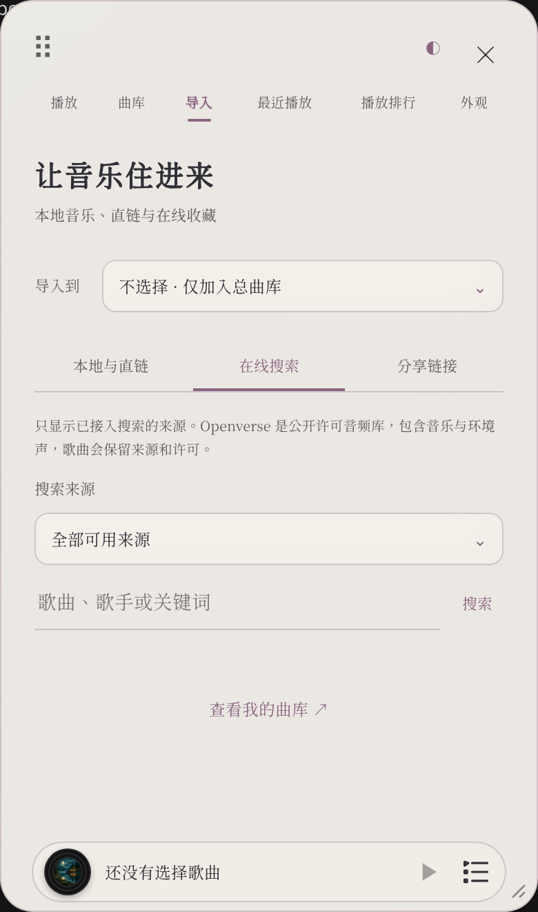

[查看来源书签预览](docs/share-preview.png)

## 默认曲库

“我的音乐”中增加独立的 **默认曲库**，不占自建歌单名额，可在外观页隐藏。你尚未确定正式歌单，本版本保留空框架，不擅自挑选音乐；安装后会明确显示“开发者尚未配置正式曲目”。

以后由开发者提供获准来源并运行 `node scripts/update-builtin.mjs --source "正式歌曲或歌单链接"`，生成随版本分发的 `builtin-tracks.js`。客户端启动不请求开发者歌单；加入自建歌单会保留用户副本，默认库的更新、删除和改名不会覆盖用户的曲目、歌单与角色绑定。来源能力不足或未读全时生成器停止，旧文件保持不变。现在也支持批量 JSON、已授权的固定公开音频直链及手动元数据、追加与只检查不写入。非完整播放条目默认拒绝，失败保留旧文件。面向非程序员的说明见 [默认曲库维护指南](docs/default-library-guide.md)。

[查看空默认曲库界面](docs/default-library.png)

## 底部播放条与当前队列

除播放页外，其余页面底部固定显示当前播放条。底栏高度约 44 个 CSS 像素，距窗口底部约 6 像素；显示底栏时隐藏原来的页脚说明。操作消息采用自动消失的浮层，不会再把底栏向上挤。左侧是中间嵌入歌曲封面的黑胶唱片，播放时旋转，暂停时停在当前角度；过长的歌名会慢速往返滚动。右侧有播放/暂停键和当前队列按钮，状态与每首歌曲右侧的按钮同步。点击唱片或歌名返回播放页，播放页隐藏这条底栏。

队列从播放器底部展开，占窗口三分之二高度，歌曲多时在列表内部滚动。它显示当前选中的歌单或总曲库，并标明来源；点歌后保持打开，方便继续选歌。系统开启“减少动态效果”时不旋转唱片、不滚动歌名。

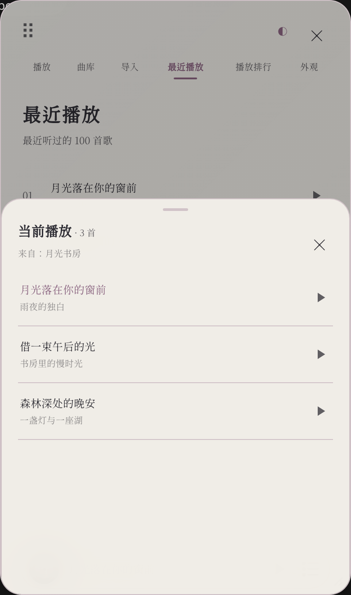

## 封面与歌词

播放页中央为大幅方形封面，进度条在下方。**轻点封面进入歌词，使用顶部“返回封面”按钮或 Esc 返回**，点击歌词文字不会退出，切换不打断音乐。歌词铺满播放器，普通行保持清晰，当前句使用强调色与字重突出。手动滚动后暂停跟随，点击“回到当前歌词”恢复；在“外观 → 文字与阅读”调整文字显示、歌词字号、行距、默认跟随和阅读背景。透明模式保留文字局部衬底，保护复杂图片上的可读性。“播放队列”从底部展开，高度限制为播放器窗口的三分之二；初始显示当前歌单或总曲库的全部歌曲，临时移除后只显示本轮保留的歌曲，点击即可播放，支持右侧播放/暂停、点击遮罩或按 Esc 关闭。

导入本地 MP3 时，会读取 ID3v2.2 / v2.3 / v2.4 中的歌名、歌手、封面和非同步歌词。MP3 没有内嵌封面、其他格式未解析封面，或当前浏览器缺少封面文件时，会使用扩展自带的三幅插画：月夜森林、暮色海面、暖光书房。无封面的歌曲随机匹配一幅，结果随歌曲保存，刷新不随意更换。默认封面随插件提供，可离线使用。

在 **曲库 → 歌曲右侧 ⋯** 中会从底部打开占播放器约三分之二高度的歌曲详情，显示封面、歌名和歌手；内容较多时可以内部滚动，点击 ×、上方遮罩或按 Esc 关闭。弹层支持深浅配色，不打断当前音乐。可以为该歌曲 **添加封面**、**导入歌词**、恢复随机封面或清除歌词。封面会处理为轻量方形图片；删除歌曲时同时清理本地音频和封面。支持 UTF-8 编码的 `.lrc`、`.txt` 歌词文件，最大 512 KB、50000 字符。


有时间轴的 LRC 会随播放和拖动进度高亮当前句；自动跟随时定位到当前句，手动阅读时只更新高亮，不强制拉回。普通文本歌词可滚动阅读。没有歌词时明确显示“暂无歌词”。支持的在线来源会保存可用封面和来源署名，但不会自动抓取网易云、QQ 音乐等商业平台的歌词；音频直链也不能保证提供封面和歌词。


## 歌单与总曲库

**曲库 → 我的音乐** 最上面显示总曲库，下方按行展示自建歌单的封面和名称，歌曲数量放在副标题中，不在名称后附加括号数字。没有自建歌单时不显示该分组。点击行进入歌曲列表，点击“‹ 我的音乐”返回；顶部不再使用歌单选择条。

点击右上角 **＋ 新建歌单**，输入名称并点 **新建**。新歌单中可点 **导入音乐** 添加文件或直链，也可点 **从总曲库选歌**：会打开总曲库并预选目标歌单，找到歌曲后点右侧 **⋯ → 加入歌单**、确认目标并提交。没有歌单时也可从歌曲的“加入歌单”中新建并直接加入该歌曲。

点击歌单行右侧 **⋯**，或进入歌单后点 **管理此歌单**，可以改名、绑定角色、删除歌单，或 **更换歌单封面**。上传图片会处理为方形缩略图，保存在当前浏览器，重新打开时仍会使用；也可恢复默认封面。没有自定义封面时使用歌单第一首歌曲的封面或内置插画。最多可以创建 50 个歌单。

播放页保留歌单切换菜单；它和导入目标、加入歌单的菜单使用跟随配色与日夜模式的磨砂样式，支持方向键、Enter 与 Esc。
在独立的 **导入** 页，可以先用 **导入到** 选择目标歌单。默认的“不选择 · 仅加入总曲库”只把歌曲加入总曲库；选择歌单则同时加入总曲库与该歌单。从歌单内点“导入音乐”会预选这个歌单；直接打开顶部“导入”页则保留上次选择。

已有曲库歌曲详情中的 **加入歌单** 可以把歌曲加入任意歌单，同一首歌可以加入多个歌单，不会复制音频文件。已有直链再次添加到另一个歌单时，也会复用曲库中的歌曲。

- 歌曲详情中的 **从此歌单移除**：仅从当前歌单移除，曲库及其他歌单仍保留歌曲。
- 歌曲详情中的 **从曲库删除**：确认后从总曲库和所有歌单中移除；本地副本在保存确认且没有有效草稿/恢复引用后回收，保存失败时保留文件。
- **删除歌单**：只删除歌单及其角色绑定，所有歌曲和音频文件都保留在总曲库。

上一首、下一首和自动循环只在当前歌单内切歌。切换歌单会暂停音乐，需要手动点播放。旧版本更新后，已有歌曲会保留在总曲库，无需重新导入。

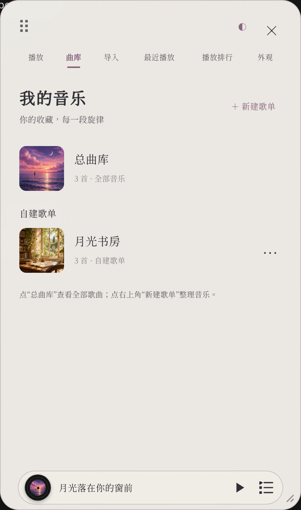

## 绑定角色卡

1. 在 **曲库** 页打开要绑定的歌单，展开 **管理此歌单**，点击 **绑定角色**。
2. 勾选一张或多张角色卡，点击 **保存绑定**。
3. 进入已绑定的角色聊天时，播放器会自动打开并切到该歌单，**只切歌单，不自动播放**；点击播放才开始听歌。

一张歌单可以绑定多张角色卡；每张角色卡使用一个自动切换的歌单。重新绑定角色时，会改用新选择的歌单。绑定使用角色卡文件标识，角色列表排序变化不会导致绑定错位；通过酒馆改名角色卡时也会更新绑定。

切换到另一张角色卡会先暂停当前音乐，再显示其绑定歌单；没有绑定的角色显示总曲库。同一角色内更换对话不会重复打断音乐。**退出角色聊天回到主页面时自动暂停**，群聊不会加载单人角色的绑定歌单。

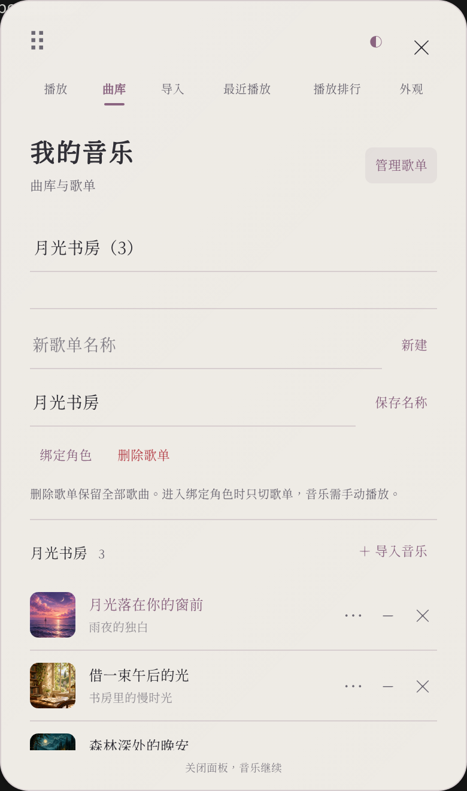

## 配色与质感

打开 **外观** 页，或点击窗口顶部的 **◐**，即可切换七组配色：夜航、暖砂、雾蓝、松绿、烟粉、月紫和珍珠白。每组均提供日间和夜间版本：**日夜外观 → 跟随系统** 会响应手机或电脑操作系统的深浅模式变化，也可固定为 **日间** 或 **夜间**，选择随酒馆用户设置保存。自定义颜色优先，不会被系统切换覆盖。悬浮唱片的边框和按钮会跟随播放器配色，更新版本会保留已有播放列表。

每组配色都支持两种质感：**雾面**使用细微颗粒和接近不透明的柔和底色，**毛玻璃**使用半透明背景、背景模糊和高光边缘。配色与质感会随酒馆设置保存，切换外观不会停止音乐。

在 **外观 → 遮罩透明度** 中可以拖动滑杆：0% 的遮罩完全不透明，100% 完全透明。雾面和毛玻璃分别记忆，切换质感不会丢失各自设置；点击 **重置透明度** 恢复当前质感的默认值。没有图片时也可以调整播放器底色的透明度，清透模式固定为完全透明。透明度只改变遮罩，毛玻璃的模糊仍然保留。

**自定义配色** 可以分别选择点缀色、背景色和文字色，修改颜色后立即生效，并同步到悬浮控件。播放按钮上的文字会根据点缀色选择深浅颜色。点击配色预设之一会恢复预设配色，自定义颜色仍然保留，可以重新勾选启用。颜色、透明度和背景图片可以一起使用，均随当前酒馆用户设置保存。

**播放器点击涟漪** 只在播放器内部显示小幅光圈，包括窗口里的空白区域，支持鼠标、触屏和键盘点击；不作用于酒馆其他区域或悬浮球。光圈不拦截输入，拖动和滑动不会误触发。在外观页取消勾选即可关闭；系统启用“减少动态效果”时也会自动关闭光圈。

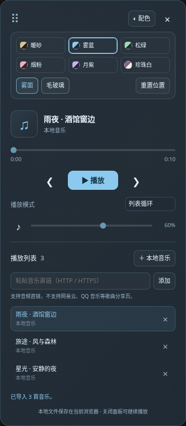

[查看图片背景下的标题与贴底播放条](docs/appearance-background.png)

## 字体选择与导入

在 **外观 → 界面字体 → 预览与选择** 中，每款字体只占紧凑的一行，字体名称使用该字体自身的字形展示，点击即可应用到播放器和歌词。当前选中项有勾选标记；方向键可以切换，Esc 收起列表。只影响播放器，酒馆其他界面保持原有字体。

除跟随酒馆、黑体、宋体、楷书、仿宋等设备字体外，内置以下两款完整小体积字库，无需连接外部字体站：

| 显示名称 | 原始字体名称 | 文件大小 |
| --- | --- | --- |
| 破晓像素 | PoxiaoPixel | 约 1.3 MB |
| 游趣体 | Child Fun Sans | 约 1.5 MB |

1.12.3 移除了超过 5 MB 的五款内置字体，包括京华老宋、源雲明體、寒蝉活宋、文鼎楷体、汇文明朝。此前选中这些内置字体时会自动回退为“跟随酒馆”，不会删除歌曲、歌单、角色绑定或用户自行导入的字体。更新前已导出的角色卡保持原样；需要减小文件时请更新后重新导出。

预览按列表可见区域加载，未加载完成时显示提示，加载失败不会拿回退字体冒充字样。系统字体以设备实际可用的字体为准。两款内置字体均为完整 WOFF2 字库，来源和授权见[字体说明](assets/fonts/README.md)。

点击 **＋ 导入字体** 可以一次选择多个 WOFF2、WOFF、TTF 或 OTF 文件，单个文件最大 20 MB，最多保留 20 款自定义字体。新导入的字体加入预览列表，可随时切换；每个自定义字体旁的 **×** 只删除该字体，删除当前使用的自定义字体会恢复“跟随酒馆”。支持安全上下文的浏览器会按文件内容识别重复导入。升级前已导入的字体及其选择会保留。

自定义字体仅保存在当前浏览器，不会上传到 GitHub 或酒馆服务器；更换设备可通过完整 ZIP 备份恢复，也可手动重新导入。内置字体随扩展提供，所有安装者均可使用。

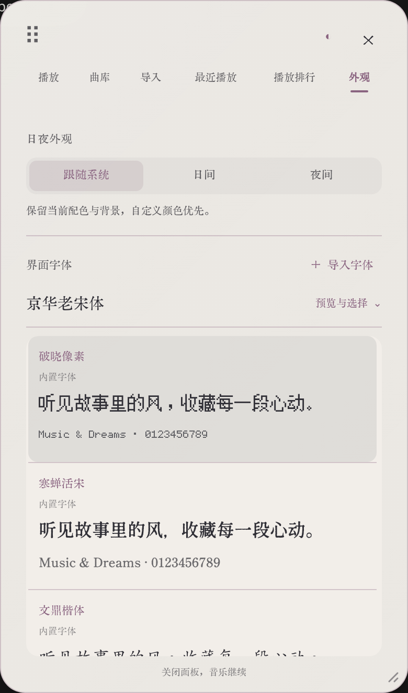

## 自定义背景与裁剪

在 **外观 → 导入背景图片** 中选择图片，然后拖动预览中的图片、调整缩放，或使用“左右”“上下”滑杆选取喜欢的区域，点击 **使用此区域**。图片会裁剪为竖幅背景；手机和电脑都可以操作。支持 PNG、JPG、WebP、GIF、AVIF，最大 10 MB、4000 万像素；动图会使用静态画面。

导入图片后，所有配色继续控制按钮、文字和图片上的色调。**雾面**在图片上叠加细微颗粒和柔和色层，**毛玻璃**模糊图片并叠加半透明色层，新增的 **清透** 则直接使用裁剪后的图片，不叠加模糊或色层。清透仅在当前浏览器已加载背景图片时可用。

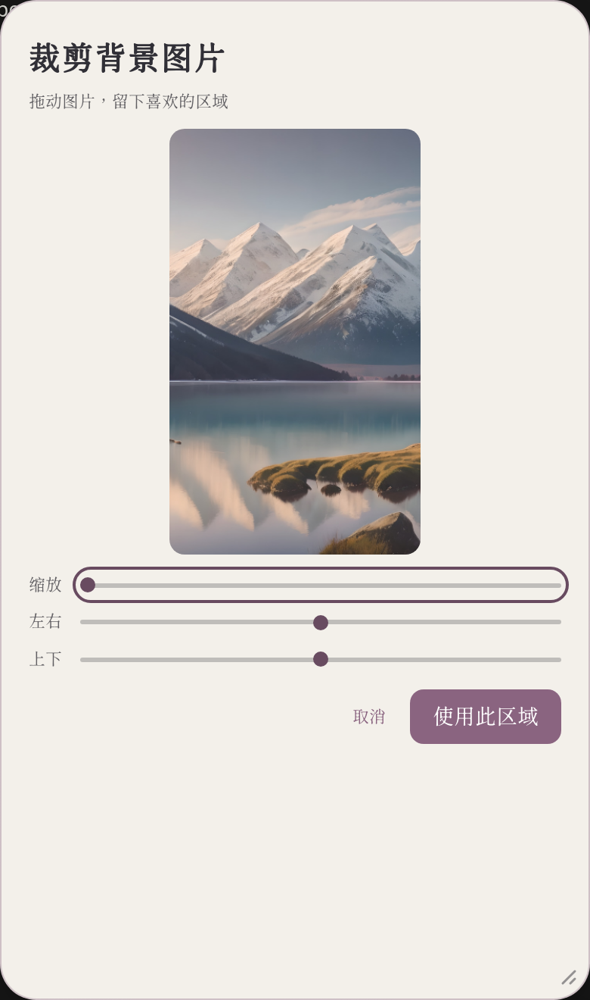


背景保存后不会留下固定的成功提示。点击 **重新裁剪** 可以从保存的原图重新选取区域；取消不会改变已有背景。点击 **移除图片** 恢复原有配色背景，如果正在使用清透，会自动恢复毛玻璃。背景原图和裁剪结果仅保存在当前浏览器，不上传到 GitHub 或酒馆服务器。其他设备可恢复完整备份或重新导入。

## 最近播放与三天排行

- **最近播放**：显示最近实际听过的 100 首不同歌曲，最近播放的排在前面；再次播放同一首会移到最前面，不重复占位。时间记录不受三天限制。
- **播放排行**：统计滚动最近 **72 小时**内的播放次数，从高到低排列；次数相同时最近播放的在前面。歌曲实际开始播放才计数，暂停后继续不重复计数；切换到其他歌曲后再切回、自动循环重播会计为新的播放。加载失败或只切换角色歌单不计数。
- 两页都提供透明的播放/暂停键，显示实际状态；当前歌曲暂停后再点会接着播放，不会重头开始。歌曲不在当前歌单时会切换到总曲库播放。删除歌单保留歌曲及播放记录，从总曲库删除歌曲则同时移除其记录。

播放记录从升级到 1.3.0 后开始收集，刷新后保留，不会自动播放。旧版本没有记录的历史无法补回。

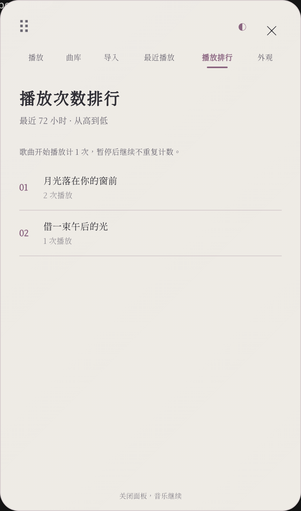

## 保存与隐私

总曲库、歌单、角色绑定、当前曲目、歌词、随机封面选择、播放记录、播放模式、音量、外观、日夜模式、字体列表、窗口大小和位置随酒馆用户设置保存。本地音频、歌曲和歌单封面、导入的字体、背景原图及裁剪后的背景保存在**当前浏览器的 IndexedDB**，不会上传到酒馆服务器，也不会进入聊天内容。

更换设备、浏览器或酒馆地址前，请导出完整 ZIP，在目标设备校验并恢复；也可手动重新导入本地音乐。只恢复酒馆设置不含本地字节，看到歌曲名称不代表文件已在该设备。清理站点数据仍会删除本地文件，备份应存到浏览器之外。账号独立存储的旧库复制、资源回收及角色重新映射见[数据维护说明](docs/data-maintenance.md)。

直链由浏览器向对应音乐网站请求。在线搜索关键词和所选分享链接会发送到对应的已接入服务；原站会收到封面和音频请求。平台元数据、来源与许可随酒馆设置保存，临时音频地址不作为永久直链保存。当前没有账号登录，不读取或共享音乐 App 的 Cookie。默认曲库随插件版本提供，目前尚无正式曲目。

## 预置音乐与公开直链

你在播放器中添加的直链和本地音乐属于自己的酒馆用户数据，不会自动写进 GitHub，也不会随别人安装插件而分发。要提供所有安装者都能看到的预置歌曲，需要另行把公开音频地址加入插件的默认曲目清单。

直链播放的过程是：插件把音频地址交给浏览器的音频播放器，安装者的浏览器从对应服务器请求音频。文件可以存放在独立的对象存储（如腾讯云 COS、阿里云 OSS、Cloudflare R2 搭配自定义域名）或自己的静态文件服务器上，插件只需要保存歌曲名称和地址。按需使用 CDN 加快不同地区的访问。

用于预置的地址应支持公开 HTTPS 访问、无需登录、不带短期到期签名，并允许音频外链；服务器支持 Range 请求会使拖动进度和继续加载更可靠。网盘分享页面、音乐平台歌曲分享页面不能直接当作音频直链。长期可用依赖存储服务、域名和访问带宽持续正常。

音频上传到独立服务器后，删除自己电脑上的原文件不会删除服务器副本，也不会影响别人播放。删除服务器上的文件、使链接失效或关闭访问权限则会影响后续播放。本地导入只会复制音频到自己的浏览器，删除电脑上的原文件后当前浏览器仍可播放，但其他人不会获得这份音频。

网易云、QQ、酷狗等商业歌单的读取和账号接入仍需维护者落实获准服务；普通用户不应被要求部署后端。分享链接识别不等于全曲播放，详细情况见 [在线平台报告](docs/online-platforms.md)。歌单分享页面不能作为音频文件地址添加。

## 更新与卸载

在酒馆的扩展管理中点击本扩展的更新按钮，更新后刷新页面。卸载可使用酒馆的扩展删除功能；如需清理本地音频，请先删除播放列表中的本地条目。卸载扩展本身不会自动清理浏览器站点存储。

## 开发与测试

运行时无需安装 npm 依赖，`manifest.json`、所有根目录 JS/CSS 文件（包括新入口 `night-ui.css`、它引用的 `style.css`）、`platforms/` 和 `assets/` 目录可以直接由酒馆加载。手动安装时请保留 `assets/`，其中包含内置封面和字体。

开发测试需要 Node.js 20 或以上：

```sh
npm ci
npm run check
npm test
```

浏览器集成测试需要**用于测试的独立酒馆用户数据目录**，测试会重置该用户的播放器列表与设置，并创建、删除临时角色卡和对话。不要直接针对日常使用的酒馆运行测试。

1. 将本仓库克隆到测试酒馆的 `public/scripts/extensions/third-party/sillytavern` 目录，或在同一位置建立指向本仓库的符号链接。
2. 使用单独的配置和用户数据目录启动测试酒馆，例如：

   ```sh
   node server.js --port 8000 --browserLaunchEnabled false --dataRoot /path/to/test-data
   ```

3. 在本插件目录运行：

   ```sh
   npx playwright install chromium
   ST_BASE_URL=http://127.0.0.1:8000 npm run test:e2e
   ```

   已安装 Chromium 的环境可以跳过浏览器下载，使用 `CHROMIUM_PATH=/usr/bin/chromium npm run test:e2e`。

测试覆盖真实酒馆扩展加载、本地音频播放、进度与音量、切歌与四种模式、刷新恢复、音频直链、删除与存储清理、错误提示、鼠标及触屏拖动、位置恢复与越界限制、六种配色和两种质感、手机屏幕布局、导入目标、共享歌曲、歌单删除保留音频、多角色绑定及主页暂停。测试使用真实角色切换 API，并检查退出时仍在读取的本地音乐不会继续播放或重新打开旧歌单。测试音频由代码生成，不依赖外部曲库。

1.3.0 的测试还验证独立页面和键盘导航、实际播放记录与暂停去重、100 首上限、72 小时排行到期、背景裁剪区域的实际像素、三种质感、背景刷新恢复和原图清理，以及手机裁剪与错误恢复。

1.4.0 增加自定义颜色、独立遮罩透明度及刷新恢复、预设切换、点击光圈生命周期、减少动态效果和拖动不误触验证。

1.5.0 验证独立曲库与导入页面、实际 MP3 播放和内嵌标签读取、封面/歌词切换、LRC 跟随、封面刷新与删除清理、三张内置封面、内置字体离线加载、自定义字体导入/恢复/失败保护，以及字体不影响酒馆其他界面。测试音频由本项目生成的正弦音组成。

1.6.0 增加七款内置字体的真实字样预览、多字体批量导入与旧设置迁移、全窗透明歌词、图标模式切换、磨砂歌单菜单、点击涟漪、窗口缩放边界与保存、触屏缩放、系统日夜跟随与手动选择验证。

1.7.0 增加勾选标记可见性、播放器内部小涟漪、单行字体预览、总曲库与歌单总览、一键新建并加入歌曲、歌单独立封面及删除清理、歌曲原地暂停续播、底部黑胶播放条、长歌名滚动，以及电脑和手机上的三分之二高度播放列表验证。

1.7.1 验证歌曲详情底部弹层在电脑和手机上的高度限制、封面编辑后的焦点恢复和继续播放、标题覆盖宿主配色、背景保存无残留提示、操作消息自动收起，以及矮版播放条贴近底部且不受提示挤压。

1.8.0 增加多平台元数据和分享链接、在线入口、来源书签、公开许可署名、有界请求与限流处理、条件启用的 Audius 分页适配器、默认曲库与生成脚本、旧数据迁移和对应测试。接口替身测试不等于外部服务实测，当前外网验证仍受开发环境限制。

1.9.0 修复强制刷新仍命中缓存、默认曲目查看详情自动复制的问题，补充实际播放检查、有界等待、选歌导入及原歌单元数据、固定公开直链默认库维护和官方 iframe 候选。新增 6 项单元与 5 项浏览器用例；官方候选按平台默认关闭，真实联网诊断另用 `npm run test:live`，未通过时返回非零。详见 [阶段报告](docs/v1.9-audit.md)。

1.10.0 正式接入 B 方案，新增独立临时队列与浏览状态、查找/筛选/显示排序、批量管理、歌单简介及永久顺序编辑。新行为由队列单元测试和真实酒馆浏览器用例覆盖；旧用例仅调整因入口移动而改变的操作路径，保留原有行为断言。详见 [本轮实施与验收记录](docs/v1.10-ui.md)。

## 许可

扩展代码和本项目生成的默认封面使用 [MIT](LICENSE)。七款内置字体分别遵循随文件提供的授权，字体来源、版权、许可和转换说明见 [字体说明](assets/fonts/README.md)。

2.0 的完整操作入口、实际截图与验收边界见 [使用说明](docs/v2/README.md) 和 [最终验证报告](docs/v2/ui/final-report.md)。随卡运行时包含共享四套布局代码，尚未按单布局裁剪；接收端不携带设计器。大卡仍受资源上限与浏览器内存影响，实体手机和真实外网音乐能力不由本地浏览器模拟测试替代。
