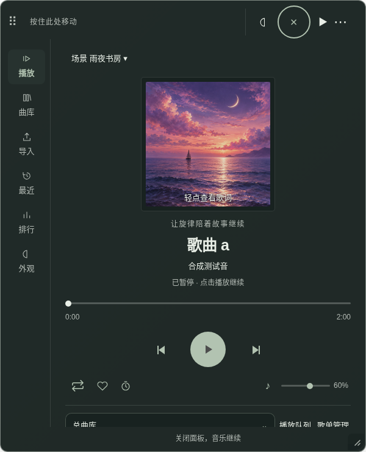
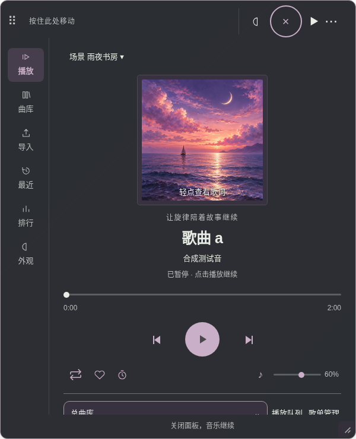
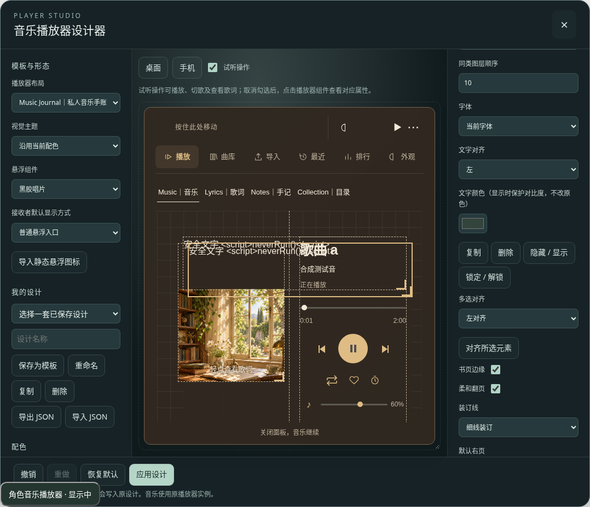
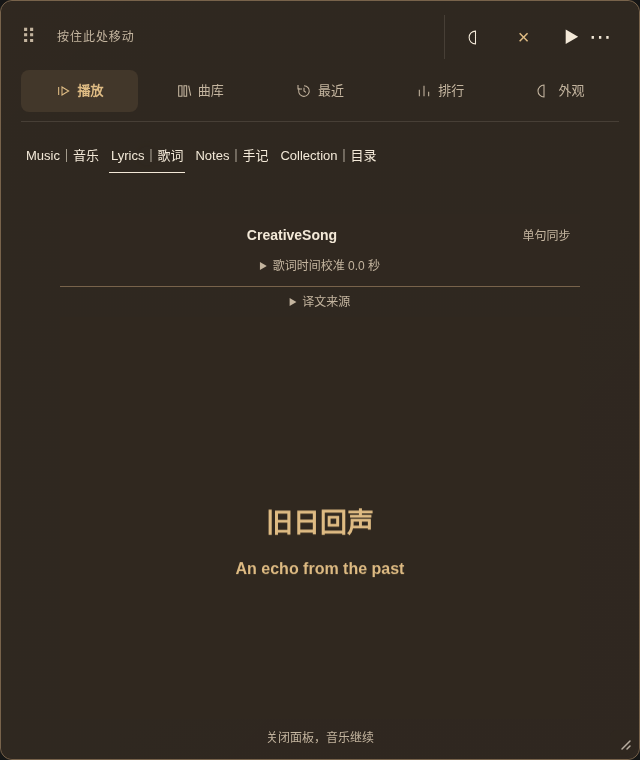

# 实际界面截图

这些是浏览器实际渲染截图，未重绘示意图。标有“夹具”的页面使用共享播放器源码及合成数据；标有“酒馆”的页面使用真实 SillyTavern + 官方 Helper，并禁用接收端完整版插件。手机均为 Chromium 触屏尺寸模拟。

| 功能 | 桌面 | 手机 |
|---|---|---|
| 逐句时间轴（夹具） | [桌面](timeline/desktop.png) | [320px](timeline/mobile-320.png) |
| 封面自动配色（同一封面／同一设计，夹具） | [关闭](delivery-gallery/cover-off.png) → [明显跟随](delivery-gallery/cover-strong.png) | [390px 六布局回归](regression-phase3/) |
| 悬浮球快捷场景（夹具） | [桌面](quick-scenes/desktop.png) | [390px](quick-scenes/mobile-390.png) |
| 音景双轨控制（夹具） | [桌面](soundscape/controls-desktop.png) | [320px](soundscape/controls-mobile-320.png) |
| 场景环境音选择（夹具） | [环境音、音量和过渡](delivery-gallery/scene-soundscape.png) | 沿用可滚动场景管理器 |
| 双语匹配编辑（夹具） | [桌面](bilingual/editor-desktop.png) | [320px](bilingual/editor-mobile-320.png) |
| 私人手记（夹具） | [桌面](journal/private-desktop.png) | [390px](journal/private-mobile-390.png) |
| 自由排版编辑器（夹具） | [桌面](journal/designer-desktop.png) | [320px](journal/designer-mobile-320.png) |
| 自由手账音乐页（夹具） | [桌面](journal/free-music-desktop.png) | [390px](journal/free-music-mobile-390.png) |
| 最终原生 PNG 接收端双语（酒馆） | [桌面](native-integrated-release/creative23-bilingual-png-desktop.png) | [触屏](native-integrated-release/creative23-bilingual-png-touch.png) |
| 最终原生 JSON 接收端私人手记（酒馆） | [桌面](native-integrated-release/creative23-private-json-desktop.png) | [触屏](native-integrated-release/creative23-private-json-touch.png) |

## 封面配色前后

关闭取色与开启“明显跟随”，保存的作者设计保持不变，仅呈现层改变：

## 自由排版与双语

