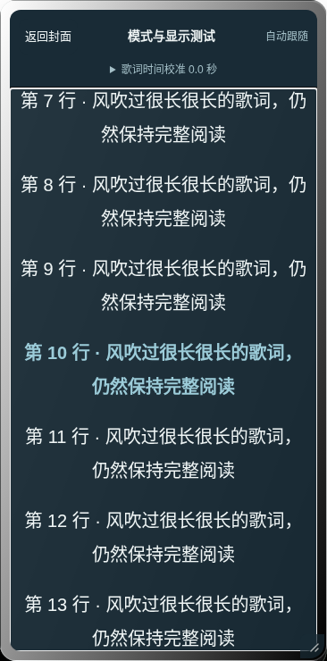
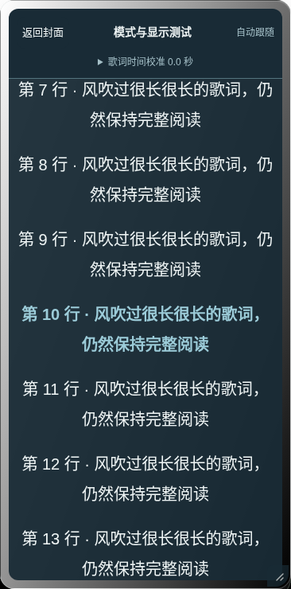
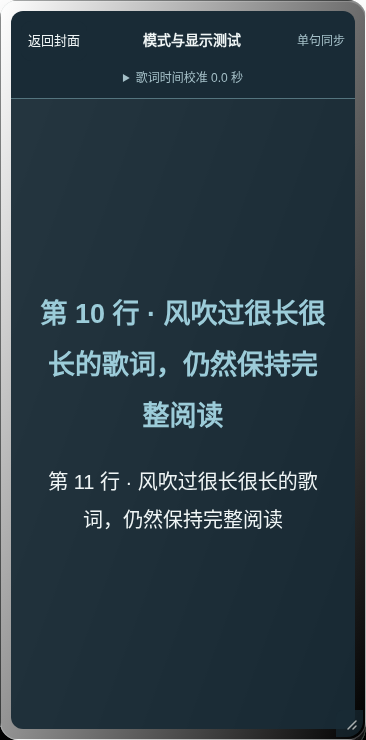

# 截图与测试入口

以下均为浏览器实际截图。手机项目是 Chromium 视口 / 触屏模拟；没有用它冒充实体手机。模式截图使用独立受控页面和真实音频，魔棒 / Helper 截图来自实际 SillyTavern 1.19.0 + 官方酒馆助手 4.11.3。

## 三种歌词模式

统一使用 Crystal Glass 与高反差图片底色，阅读区只有整体遮罩，没有逐句文字背景框。

| 模式 | 手机深色 | 手机浅色 | 桌面深色 | 桌面浅色 |
| --- | --- | --- | --- | --- |
| 连续滚动 | [查看](screenshots/flow-dark-mobile-chromium-emulation.png) | [查看](screenshots/flow-light-mobile-chromium-emulation.png) | [查看](screenshots/flow-dark-desktop.png) | [查看](screenshots/flow-light-desktop.png) |
| 居中阅读 | [查看](screenshots/centered-dark-mobile-chromium-emulation.png) | [查看](screenshots/centered-light-mobile-chromium-emulation.png) | [查看](screenshots/centered-dark-desktop.png) | [查看](screenshots/centered-light-desktop.png) |
| 单句沉浸 | [查看](screenshots/immersive-dark-mobile-chromium-emulation.png) | [查看](screenshots/immersive-light-mobile-chromium-emulation.png) | [查看](screenshots/immersive-dark-desktop.png) | [查看](screenshots/immersive-light-desktop.png) |

| 连续滚动 | 居中阅读 | 单句沉浸 |
| --- | --- | --- |
|  |  |  |

## 贴边和独立预览

| 场景 | 桌面测试项目 | 手机尺寸测试项目 |
| --- | --- | --- |
| 贴边标签 | [查看](screenshots/docked-desktop.png) | [查看](screenshots/docked-mobile-chromium-emulation.png) |
| 320px 左侧 | [查看](screenshots/left-320-desktop.png) | [查看](screenshots/left-320-mobile-chromium-emulation.png) |
| 320px 右侧 | [查看](screenshots/right-320-desktop.png) | [查看](screenshots/right-320-mobile-chromium-emulation.png) |
| 横屏左侧 | [查看](screenshots/left-844-desktop.png) | [查看](screenshots/left-844-mobile-chromium-emulation.png) |
| 横屏右侧 | [查看](screenshots/right-844-desktop.png) | [查看](screenshots/right-844-mobile-chromium-emulation.png) |
| 经典独立预览 | [查看](screenshots/classic-desktop.png) | [查看](screenshots/classic-mobile-chromium-emulation.png) |

390×360 的高度变化截图也保存在同一目录。高度模拟不等于真实软键盘。经典预览中的恢复按钮是模拟入口，不能称为真实魔棒。

## 真实酒馆恢复入口

每个场景先在未安装完整版插件的接收页面打开卡片，再隐藏播放器，打开真正的魔棒菜单。另移除测试页魔棒容器，实际点击 Helper 的独立脚本按钮恢复，随后还原原容器；没有改动其他菜单项目或全局显示策略。

| 布局 | PNG 魔棒 | JSON 魔棒 | Helper 备用入口 |
| --- | --- | --- | --- |
| 黑胶 / 桌面 | [查看](native-menu-final/wand-hidden-vinyl-png-desktop.png) | [查看](native-menu-final/wand-hidden-vinyl-json-desktop.png) | [查看](native-menu-final/helper-recovery-vinyl-json-desktop.png) |
| 玻璃 / 手机尺寸 | [查看](native-menu-final/wand-hidden-crystal-png-mobile.png) | [查看](native-menu-final/wand-hidden-crystal-json-mobile.png) | [查看](native-menu-final/helper-recovery-crystal-json-mobile.png) |

完整正文见[使用与验收报告](README.md)。

四布局的普通播放页另见： [黑胶](native/native-vinyl-desktop-playback.png)、[玻璃](native/native-crystal-mobile-playback.png)、[磁带](native/native-cassette-desktop-playback.png)、[极简](native/native-pure-mobile-playback.png)。宿主恢复入口的最终样式复验使用前表两种视口，旧灰底截图只作为诊断记录。
