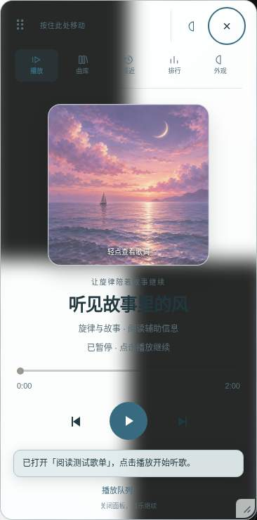
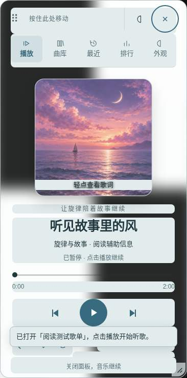
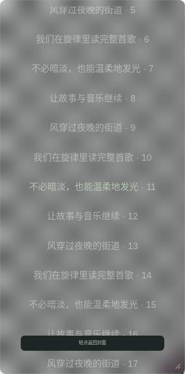
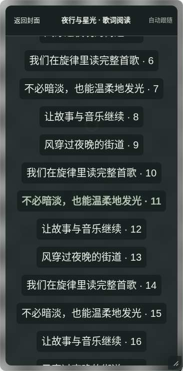

# 前后截图索引

播放页使用 `e3d5c4e` 中冻结的旧共享运行时与本轮运行时，在同一图片、歌曲、模式和视口下分别渲染；角色事件是夹具，不代表酒馆助手生命周期测试。歌词页为修改前后实际浏览器渲染。JPEG 仅作观察，对比度数值来自渲染检查，不从有损截图反算。

| 配色或形态 | 播放页：前 / 后（手机浅色） | 歌词：前 / 后（手机深色） |
| --- | --- | --- |
| night | [前](playback/before/night-light-mobile.jpg) / [后](playback/after/night-light-mobile.jpg) | [前](before/night-dark-mobile.jpg) / [后](after/night-dark-mobile.jpg) |
| amber | [前](playback/before/amber-light-mobile.jpg) / [后](playback/after/amber-light-mobile.jpg) | [前](before/amber-dark-mobile.jpg) / [后](after/amber-dark-mobile.jpg) |
| ocean | [前](playback/before/ocean-light-mobile.jpg) / [后](playback/after/ocean-light-mobile.jpg) | [前](before/ocean-dark-mobile.jpg) / [后](after/ocean-dark-mobile.jpg) |
| forest | [前](playback/before/forest-light-mobile.jpg) / [后](playback/after/forest-light-mobile.jpg) | [前](before/forest-dark-mobile.jpg) / [后](after/forest-dark-mobile.jpg) |
| rose | [前](playback/before/rose-light-mobile.jpg) / [后](playback/after/rose-light-mobile.jpg) | [前](before/rose-dark-mobile.jpg) / [后](after/rose-dark-mobile.jpg) |
| lavender | [前](playback/before/lavender-light-mobile.jpg) / [后](playback/after/lavender-light-mobile.jpg) | [前](before/lavender-dark-mobile.jpg) / [后](after/lavender-dark-mobile.jpg) |
| pearl | [前](playback/before/pearl-light-mobile.jpg) / [后](playback/after/pearl-light-mobile.jpg) | [前](before/pearl-dark-mobile.jpg) / [后](after/pearl-dark-mobile.jpg) |
| crystal | [前](playback/before/crystal-light-mobile.jpg) / [后](playback/after/crystal-light-mobile.jpg) | [前](before/crystal-dark-mobile.jpg) / [后](after/crystal-dark-mobile.jpg) |
| vinyl | [前](playback/before/vinyl-light-mobile.jpg) / [后](playback/after/vinyl-light-mobile.jpg) | [前](before/vinyl-dark-mobile.jpg) / [后](after/vinyl-dark-mobile.jpg) |
| cassette | [前](playback/before/cassette-light-mobile.jpg) / [后](playback/after/cassette-light-mobile.jpg) | [前](before/cassette-dark-mobile.jpg) / [后](after/cassette-dark-mobile.jpg) |
| pure | [前](playback/before/pure-light-mobile.jpg) / [后](playback/after/pure-light-mobile.jpg) | [前](before/pure-dark-mobile.jpg) / [后](after/pure-dark-mobile.jpg) |
| custom | [前](playback/before/custom-light-mobile.jpg) / [后](playback/after/custom-light-mobile.jpg) | [前](before/custom-dark-mobile.jpg) / [后](after/custom-dark-mobile.jpg) |

每个目录还包含对应的桌面及另一明暗模式截图：`主题-dark/light-desktop/mobile.jpg`。共 96 对（192 张）截图；对照页面见 [gallery.html](gallery.html)。

| 玻璃播放页：前 | 玻璃播放页：后 |
| --- | --- |
|  |  |

| 夜航歌词：前 | 夜航歌词：后 |
| --- | --- |
|  |  |

## 真实酒馆干净接收端

以下为 SillyTavern 1.19.0 + 官方酒馆助手 4.11.3 的测试截图。接收端阻断完整版插件资源；手机项是 Chromium 手机尺寸与触屏模拟。

| 布局 / 视口 | 原生 PNG 导入 | 原生 JSON 导入 | 播放状态 |
| --- | --- | --- | --- |
| Vinyl Atelier / 桌面 | [PNG](native-final/native-vinyl-desktop-png.png) | [JSON](native-final/native-vinyl-desktop-json.png) | [播放](native-final/native-vinyl-desktop-playback.png) |
| Crystal Glass / 手机尺寸 | [PNG](native-final/native-crystal-mobile-png.png) | [JSON](native-final/native-crystal-mobile-json.png) | [播放](native-final/native-crystal-mobile-playback.png) |
| Cassette Memory / 桌面 | [PNG](native-final/native-cassette-desktop-png.png) | [JSON](native-final/native-cassette-desktop-json.png) | [播放](native-final/native-cassette-desktop-playback.png) |
| Pure Form / 手机尺寸 | [PNG](native-final/native-pure-mobile-png.png) | [JSON](native-final/native-pure-mobile-json.png) | [播放](native-final/native-pure-mobile-playback.png) |

制作器：[制作页](maker/maker-desktop.png)、独立导出后的 [桌面](maker/json-desktop.png) / [手机尺寸](maker/json-mobile.png)。
