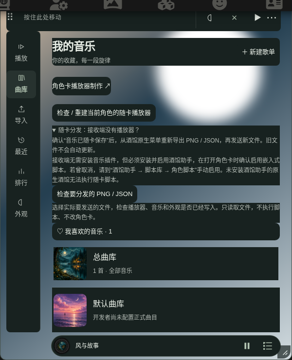
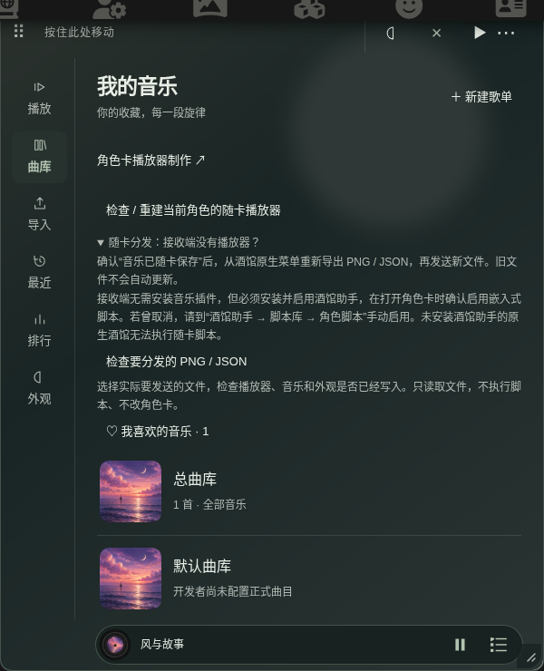

# 普通文字背景块修复 · 2.0.0-alpha.8

本轮以 main `6dccadf`（alpha.7）为基线，修复普通文字和多层正文容器被单独涂底的问题。没有重做布局，没有修改用户保存的配色、歌曲、歌单、角色绑定或 IndexedDB 格式。

[修改文件与具体位置](changes.md)。

## 修了什么

根因是旧版 `ui/reading.css` 对 `p / label / small / h3 / summary` 及歌曲信息、标题、设置分组、列表行等容器强制绘制 `--read-surface`。其中 `.stm-player-controls` 在四套布局中为 `display:contents`，不绘制背景，之前又给它的子文字补了底色，形成层层矩形。这些原始规则已删除，没有在末尾追加全局 `transparent !important`。

- `ui/reading.css`：移除普通语义文字及正文分组的强制填充；合并歌词原始规则，消除先加框再覆盖的写法。按钮、输入框、下拉菜单、弹层、完整制作页、提示浮层和迷你播放条按明确组件保留背景。
- `ui/layouts.css`：移除黑胶布局歌曲信息外层的渐变铭牌；关闭作者背景图片或设计器背景组件时仍保留阅读保护。
- `ui/contrast.js`、`ui/reading.js`：使用一层覆盖整个播放器的连续主题色遮罩保护图片和玻璃背景。以遮罩下黑、白像素两端及不透明控件面作为有效背景，统一检查正文、辅助色、强调色、错误／警告色和组件自定义色。不采样图片，不增加定时器，不改变锁定的原始颜色。
- `card-player/runtime.js`：经典制作器预览及旧独立播放器同样去掉标题、说明、列表和设置分组的底块；保护放在整个面板的背景层。
- 已重建 `card-player/dist/` 的共享 UI、原生随卡运行时、经典运行时及开发测试脚本。原生 PNG/JSON 仍携带同一套共享界面。

当前选中标签／歌曲整行、磁带图案上的标签、唱片结构等完整组件保留原有设计。普通文字本身不填色，说明区的父容器也不填色。

## 实际画面对照

下面来自真正的 SillyTavern 页面，使用相同测试歌曲、窗口尺寸、主题及导入图片背景。封面缺省图按原机制随机分配，因此个别封面可能不同。没有修改图片内容。

| 随卡分发：修复前 | 随卡分发：修复后 |
| --- | --- |
|  |  |

[全部 80 组前后截图](screenshots.md)覆盖夜航、Crystal Glass、Vinyl Atelier、Cassette Memory、Pure Form，每套包括播放、曲库、收藏、歌单详情、导入、外观、随卡分发和歌词页。桌面展示深色、手机尺寸展示浅色；两种尺寸的两种色调均执行样式断言。

## 文字与背景规范

| 文字 | 呈现与最低要求 |
| --- | --- |
| 标题／正文 | 不透明 `--read-title / --read-body`；清晰模式目标 7:1，高对比度目标 9:1 |
| 辅助说明／标签／时间 | 不透明 `--read-secondary / --read-hint`，至少 4.5:1 |
| 普通歌词 | 不透明 `--read-lyrics`，没有逐行底块 |
| 当前歌词 | `--read-current` 与适度加粗，不压暗其他句子；至少 4.5:1 |
| 强调色、错误、警告 | `--read-accent / --read-error / --read-warning`，至少 4.5:1 |
| 自定义组件文字 | 仅调整显示色，保留保存的自定义色与不透明度；至少 4.5:1 |
| 主操作按钮 | `--read-on-action` 对 `--read-action` 至少 4.5:1 |

具体颜色随预设和深浅模式变化，不能用一组固定 HEX 代表全部主题。常规文字位于整个播放器的 90% 主题色连续遮罩之上；歌词整体阅读区域仍有 90%／95%／不透明的三档区域遮罩。阴影、材质和原图保留在背景层，不给每段文字加矩形。详细测量见[主题结果](themes.md)。

## 验收口径

测试数据全部在独立测试酒馆与临时浏览器中生成，没有使用日常聊天数据。真实酒馆页面中的设置接口注入合成测试曲库，用于隔离已有账号数据；页面、插件、DOM 和音频播放均为实际运行。

- `test:text-surfaces`：真实酒馆中的五布局 × 两色调 × 两尺寸 × 八页面，共 160 个逐页场景。直接读取普通文字及父容器的 Computed Style，检查 `background-color`、`background-image`、实际绘制层、对比度和同一音频实例；同时确认真实控件保留填充。
- `test:reading`：旧配色、新主题、材质及图片极端像素的实际渲染矩阵，另含阅读自由滚动、返回当前句、设计器、旧设置、ZIP 与经典播放器检查。测量会跳过不绘制的 `display:contents`，计入真实背景伪元素，不把主题 HEX 当作图片像素。
- `test:modes`：三种歌词模式、时间校准、手动阅读、贴边、隐藏暂停、魔棒／Helper 入口失效回退以及清理。
- 原生随卡：在官方酒馆助手启用状态下，从作者端实际导出 PNG/JSON，在阻止完整版插件加载的干净接收端导入、进入角色、播放内嵌测试音、显示歌词、隐藏恢复及切换角色；同时检查同角色聊天／开场白／回复切换。
- 数据回归：真实 IndexedDB、ZIP、损坏导入、空间不足、草稿和设置保存失败保护。

最终逐项计数、命令、成功／失败记录和运行时摘要保存在 [results](results/)；本次执行总表见 [验收结果](results/acceptance.json)。首次完整回归还复现了设计器背景组件关闭时隐藏 `::after` 的覆盖冲突，标题对比度降至约 1.55:1；已修正 `ui/layouts.css` 的原始隐藏规则，背景关闭现在只隐藏图片层。失败原始输出保存在 [reading-initial-failure.log](results/reading-initial-failure.log)，修复后重新构建并重跑。初跑测试脚本另曾把选中整行误判成文字底块，并存在收藏按钮定位歧义；已修正测试定位和组件边界后完整重跑，没有删除对普通文字或对比度的断言。

## 如何使用更新

1. 完整插件用户在扩展管理中更新本仓库，然后刷新酒馆；原有数据直接继续使用。
2. 已导出的卡片不会自动更新内嵌脚本。作者打开对应角色，在曲库上方点击 **「检查 / 重建当前角色的随卡播放器」**，等保存成功，再从酒馆原生菜单重新导出 PNG / JSON。
3. 接收端使用新文件，仍须启用酒馆助手角色脚本。无需安装完整版音乐插件。接收者的个人阅读、隐藏和恢复设置继续有效。

## 边界与回退

浏览器实测使用 Chromium，手机尺寸为 Chromium 触屏模拟，**不代表实体 iPhone／Android、Safari／Firefox 通过**。外网商业音乐播放不在本次样式修复的验证范围；音频实测为同源测试直链和随卡内嵌合成 MP3，少数 HTTPS 请求使用受控网络替身，不能算真实外网播放。不能据此宣布第三方平台播放成功。

本次没有数据迁移；回退代码及对应构建产物即可回退显示行为。已分发卡片始终保留导出时的脚本，需要重新导出才能更换版本。没有生成离线安装包。
